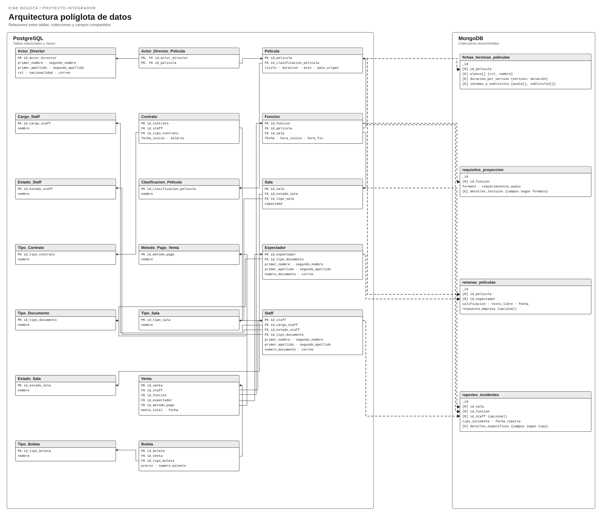

# Avance 2 — Capa documental MongoDB

Esta guía describe la carpeta de entrega del avance 2 para el repositorio **Cine Bogotá**. El PDF se entrega por separado; no se agrega al repositorio.

## Estructura

```text
avance2-mongodb/
├── diagrama-arquitectura-poliglota/
│   └── diagrama-arquitectura-poliglota.svg
├── scripts/
│   ├── 01_creacion_colecciones.js
│   ├── 02_datos_prueba.js
│   └── 03_consultas.js
├── evidencias/
│   ├── 00_entorno.txt
│   ├── 01_creacion_colecciones.txt
│   ├── 02_datos_prueba.txt
│   ├── 03_consultas.txt
│   ├── 04_conteos.txt
│   ├── 05_validadores.txt
│   └── 06_repeticion_carga.txt
```

El requisito de evidencias se cumple con capturas de pantalla auténticas tomadas durante la ejecución de MongoDB. Los archivos `.txt` de esta carpeta son registros auxiliares y no sustituyen las capturas. Las imágenes deben mostrar la ejecución real de los tres scripts, los conteos de 30 documentos por colección, las consultas (incluidas agregaciones) y el rechazo de documentos inválidos por los validadores. Deben guardarse como PNG dentro de `avance2-mongodb/evidencias/`. Las capturas todavía están pendientes de la integrante asignada; no se han creado imágenes simuladas.



## Ejecución con Docker Desktop

Desde la raíz del repositorio, con Docker Desktop iniciado:

```powershell
docker run -d --name cine-umbral-mongodb -p 27017:27017 mongo:8.0
docker cp .\avance2-mongodb\scripts\01_creacion_colecciones.js cine-umbral-mongodb:/tmp/01_creacion_colecciones.js
docker cp .\avance2-mongodb\scripts\02_datos_prueba.js cine-umbral-mongodb:/tmp/02_datos_prueba.js
docker cp .\avance2-mongodb\scripts\03_consultas.js cine-umbral-mongodb:/tmp/03_consultas.js
docker exec cine-umbral-mongodb mongosh cine_bogota_avance2 --file /tmp/01_creacion_colecciones.js
docker exec cine-umbral-mongodb mongosh cine_bogota_avance2 --file /tmp/02_datos_prueba.js
docker exec cine-umbral-mongodb mongosh cine_bogota_avance2 --file /tmp/03_consultas.js
```

Al terminar, detén y elimina el contenedor temporal:

```powershell
docker rm -f cine-umbral-mongodb
```

Si ya tienes MongoDB y `mongosh` instalados localmente, también puedes correr cada archivo desde la raíz:

```powershell
mongosh "mongodb://localhost:27017/cine_bogota_avance2" --file .\avance2-mongodb\scripts\01_creacion_colecciones.js
mongosh "mongodb://localhost:27017/cine_bogota_avance2" --file .\avance2-mongodb\scripts\02_datos_prueba.js
mongosh "mongodb://localhost:27017/cine_bogota_avance2" --file .\avance2-mongodb\scripts\03_consultas.js
```

Los scripts pueden repetirse. La creación actualiza validadores e índices; la carga hace `replaceOne` con `upsert` usando los `_id` de la semilla. No ejecutan `dropDatabase`, `drop` ni `deleteMany`.

## Correspondencia con PostgreSQL

Los IDs documentados se cotejaron con `avance1-postgresql/scripts/01_creacion_tablas.sql` y `02_datos_prueba.sql`. PostgreSQL sigue siendo la fuente de verdad para películas, funciones, salas, espectadores, ventas y boletas. MongoDB conserva el ID relacional correspondiente como referencia; no se simulan claves foráneas entre motores.

| Colección MongoDB | IDs compartidos de PostgreSQL | Semilla |
| --- | --- | ---: |
| `fichas_tecnicas_peliculas` | `Pelicula.id_pelicula`, `Pelicula.id_clasificacion_pelicula`, `Actor_Director.id_actor_director` | 30 versiones: 3 por película para las 10 películas |
| `requisitos_proyeccion` | `Funcion.id_funcion`, `Funcion.id_pelicula`, `Funcion.id_sala` | 30: una por función |
| `resenas_peliculas` | `Pelicula.id_pelicula`, `Espectador.id_espectador` | 30 |
| `reportes_incidentes` | `Funcion.id_funcion`, `Sala.id_sala`; opcionales `Venta.id_venta` y `Espectador.id_espectador` | 30 |

La integración final debe validar que estos IDs existan en PostgreSQL desde la aplicación que escriba los documentos. El `id_venta` de un incidente es opcional.

## Decisiones del modelo documental

- **Embebido:** cada ficha contiene el elenco, idiomas, subtítulos y clasificaciones por país. Son datos que suelen leerse junto con la ficha y pueden variar entre películas. Cada entrada de elenco mantiene `id_actor_director` para rastrear la persona maestra en PostgreSQL.
- **Referenciado:** reseñas e incidentes viven en colecciones independientes porque crecen con el tiempo, tienen autores/funciones identificables y estructuras variables. Los requisitos técnicos apuntan a `id_funcion`, `id_pelicula` e `id_sala`; así no se duplica el núcleo de programación de PostgreSQL.
- **Versiones:** una ficha representa una combinación película-variante. Esto conserva duración y especificaciones distintas sin alterar las diez películas relacionales del avance 1.
- **Límites de los datos conocidos:** la base relacional registra salas Digital, 3D y 4D. Las solicitudes de IMAX o Dolby Atmos en ejemplos quedan marcadas `por_validar`; no afirman que el cine ya tenga esos equipos.

El archivo SVG de `avance2-mongodb/diagrama-arquitectura-poliglota/` relaciona las entidades de PostgreSQL con las cuatro colecciones y muestra los campos de enlace compartidos.

## Alcance de alta disponibilidad

La ejecución de prueba documentada usa un contenedor MongoDB único, sin Replica Set. Comprueba creación de colecciones, validadores, datos y consultas; no demuestra replicación, elección de primario ni failover.

Como estrategia de despliegue, una aplicación podría usar PostgreSQL con réplicas de streaming para mantener servidores standby al día mediante WAL, y MongoDB en un Replica Set con elecciones automáticas. Esa estrategia no está configurada por estos scripts. Durante una elección de MongoDB las escrituras se detienen hasta que haya un nuevo primario. Las lecturas desde secundarios pueden continuar si la aplicación las configura, pero pueden devolver datos atrasados porque la replicación es asíncrona. Por eso, una lectura de reseñas solo debería enviarse a un secundario si la aplicación acepta esa demora; ventas y disponibilidad de asientos deben seguir el flujo transaccional de PostgreSQL.

El trade-off de CAP depende de la topología y de la operación: ante una partición, permitir lecturas desde una réplica puede mantener acceso a datos con consistencia eventual, mientras las escrituras esperan a que el Replica Set elija un primario. El sistema no debe describirse como simplemente “CP” o “AP” sin especificar ese comportamiento. La replicación mejora disponibilidad frente a fallas de nodos, pero no reemplaza los backups.

Referencias técnicas: [elecciones de Replica Set en MongoDB](https://www.mongodb.com/docs/manual/core/replica-set-elections/), [consistencia y lecturas desde secundarios en MongoDB](https://www.mongodb.com/docs/manual/core/read-isolation-consistency-recency/) y [replicación streaming de PostgreSQL](https://www.postgresql.org/docs/current/warm-standby.html).

## Participación del equipo

El grupo tiene cuatro integrantes. La asignación de revisión y commits se encuentra en [REPARTO_AVANCE2.md](./REPARTO_AVANCE2.md); cada integrante debe revisar o completar su frente desde su propia cuenta de GitHub. El informe PDF se trabajará aparte.
